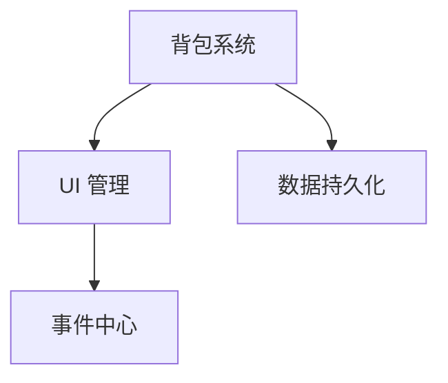

# [名字 / Hentai]

[一句话:Unity 客户端开发,方向 + 在找什么岗位]

## 项目

### [对口项目名]
[一句话介绍] · [视频](B站链接) · [源码](仓库链接)
- 亮点:[最能代表你的 1~2 个系统]

### [另一个项目名]
[一句话介绍] · [视频](B站链接) · [源码](仓库链接)

### Unity 客户端基础框架
[一句话介绍] · [源码](仓库链接)

## 技术栈
C# · Unity · UGUI · ……(只写扛得住追问的)

## 学习记录与联系方式
- 知识库:https://rayhentai.github.io/Ray-s-game-development-knowledge-base/
- 邮箱:1197856484@qq.com

模板 B:项目仓库 README(作品集里每个项目都用这个)
# [项目名]

> [一句话:品类 + 核心玩法 + 个人开发,基于自己实现的基础框架]

## 演示视频

[1~2 分钟,视频里展示了哪些系统]

## 我实现的系统
| 系统 | 做了什么 | 关键实现 |
|---|---|---|
| [背包] | [拖拽、合并、拆分] | [UI 管理 + 事件中心] |

## 架构图

## 技术难点
### 难点 1:[一句话说清是什么问题]
- **问题**:[现象,在什么情况下出现]
- **定位**:[怎么找到原因,用了什么工具]
- **方案**:[怎么解决的]
- **取舍**:[还考虑过哪些方案,为什么没选]
- **效果**:[数据,比如 DrawCall X → Y]

## 运行方式
- Unity 版本:[版本号]
- 打开 [场景名] 运行

## 说明
- 学习来源:[课程名];在原课程基础上,我自己加了:[扩展或变体]
- 美术资源:[来源;如果没放进仓库,在这里说明]
